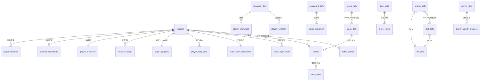

# 食灵月城 · 数据库设计文档

> 版本：v1.0　|　撰写：技术负责人（程基岩）　|　基于：`backend/src/db/schema.sql`（47 表 / 迁移至 v6）
> 数据库：SQLite 3.37+（node:sqlite 内置驱动）　|　后端：TypeScript + Express 风格路由

## 全库约定（所有 DDL 与代码的硬约束）

1. **主键**：应用侧生成 UUID 文本（`src/lib/ids.ts` 的 `newId()`），禁止自增。
2. **时间**：ISO-8601 UTC 文本（`src/lib/clock.ts` 的 `nowIso()`），可直接字符串排序比较；自然日以 `day_key`（`YYYY-MM-DD`）表达。
3. **布尔**：INTEGER 0/1，配合 `CHECK (col IN (0, 1))`。
4. **金额/资源/数值**：一律整数，禁止浮点；概率/倍率用**万分比基点**（`*_bp`，1.25 倍存 `12500`）。
5. **表前缀**：`*_defs` 为静态配置（seed 写入，可重复 upsert）；`player_*` 为玩家动态数据；`gm_*` / `*_logs` 为运营与审计数据。
6. **结构版本**：`schema_migrations` 记录版本，`migrate.ts` 幂等执行；新增结构追加 MIGRATIONS 清单项，不修改历史版本。

---

## 一、现有表核对清单

主理人点名的 11 张表逐一核对结论（判定基于 `schema.sql` v6 全量核对）：

| # | 点名表 | 判定 | 映射到现有表 | 说明 |
|---|--------|------|--------------|------|
| 1 | 装备表 | ✅ 已存在 | `equipment_defs` + `player_equipment` | 定义含 6 维属性与槽位；实例含强化等级（0–5）与穿戴槽位（部分唯一索引保证一槽一件） |
| 2 | 充值表 | ✅ 已存在 | `shop_pack_defs` + `player_purchases` + `payment_orders` | 礼包定义 → 购买记录 → 支付订单三层齐全，订单含防重放（`gateway_txn` 部分唯一索引 + 锁价签名） |
| 3 | 战斗表 | ✅ 已存在 | `stage_defs` + `battles` + `battle_turns` + `battle_passes` | 关卡定义 / 战斗实例（服务端种子）/ 逐回合回放 / 每日挑战次数四层齐全；唯一缺口是敌方单位无实体（见 #7–#10） |
| 4 | 场景表 | ⚠️ 部分覆盖 | `stage_defs` 仅承担战斗关卡 | 无通用「场景/地图」概念（主城、协会驻地、活动场景均无落点）。补全方案见 §2.7 `scene_defs` |
| 5 | 物品表 | ⚠️ 部分覆盖 | `player_resources`（7 种货币固定列）+ 各 `*_defs` | 货币体系完整且有流水；但**无通用物品定义表与背包实例表**，材料/消耗品/碎片无处安放。补全方案见 §2.5 |
| 6 | 活动表 | ⚠️ 部分覆盖 | `player_progress` 的 `first_claimed_json` / `seven_claimed_json` / `bp_claimed_json` / `fund_claimed_json` / `chronicle_claimed_json` 等列 | 领取状态散落 JSON 列，无活动定义、无起止时间、无独立进度，运营无法配置新活动。补全方案见 §2.6 |
| 7 | 怪物表 | ❌ 完全缺失 | `battles.enemy_power` 仅为抽象战力数值 | 敌方单位无名字、无属性、无技能、无掉落。建表方案见 §2.1 `enemy_defs` |
| 8 | Boss 表 | ❌ 完全缺失 | 同上 | 建议以 `enemy_defs.kind = 'boss'` 判别承载（设计决策 D-1），Boss 阶段机制放 `phase_json` |
| 9 | 特效表 | ❌ 完全缺失 | 无 | 客户端表现资产无服务端登记，引用无法校验。见 §2.3 `vfx_defs` |
| 10 | 技能表 | ❌ 完全缺失 | `battle_turns.skill` 为裸 TEXT | 技能无定义、无数值系数，回放字段无法校验。见 §2.2 `skill_defs`（含对 `battle_turns.skill` 的兼容策略 D-2） |
| 11 | GM 表 | ❌ 完全缺失 | 无 | 无 GM 账号、无权限分级、无审计、无封禁。完整方案见 §2.8（`gm_accounts` / `gm_audit_logs` / `gm_player_bans` + 个性化邮件 `player_system_mails`） |

**已存在、可直接复用的标准系统**（本章不再重复建表）：

- 任务：`quest_defs`（含服务端可算的 `metric` 进度指标）+ `player_quest_claims`
- 好友：`friendships`（双向行 + `status` 方向状态，`CHECK (player_id <> friend_id)`）
- 公会：`guilds` + `guild_members`（含 leader/officer/member 角色与签到）
- 聊天：`chat_messages`（world / guild 双频道，长度约束）
- 资源流水：`resource_ledger`（每次增减留痕，含 `balance_after` 快照，对账与反作弊复盘的基础）

---

## 二、缺失表建表方案

以下每节按「SQL DDL → 配套逻辑代码 → 功能实现说明」给出。SQL 均追加进 `schema.sql` 对应分区，并在 `MIGRATIONS` 中登记（流程见第五章）。

### 2.1 怪物表 `enemy_defs`（含 Boss，v7）

#### DDL

```sql
-- -----------------------------------------------------------------------------
-- 15. 战斗内容：怪物 / Boss（v7）
-- -----------------------------------------------------------------------------
-- 敌方单位定义。Boss 不单独建表，以 kind 判别（设计决策 D-1）：
--   normal：普通怪，直接参与战斗快照；
--   elite ：精英怪，可携带 1–2 个技能；
--   boss  ：Boss，额外使用 phase_json 描述阶段机制。
CREATE TABLE IF NOT EXISTS enemy_defs (
  id          TEXT PRIMARY KEY,
  name        TEXT NOT NULL,
  kind        TEXT NOT NULL CHECK (kind IN ('normal', 'elite', 'boss')),
  element     TEXT NOT NULL,
  power       INTEGER NOT NULL CHECK (power > 0),
  health      INTEGER NOT NULL CHECK (health > 0),
  attack      INTEGER NOT NULL CHECK (attack > 0),
  defense     INTEGER NOT NULL DEFAULT 0 CHECK (defense >= 0),
  speed       INTEGER NOT NULL DEFAULT 0 CHECK (speed >= 0),
  -- 技能列表：JSON 数组，按出手优先级引用 skill_defs.id，服务端结算前校验存在性
  skill_ids   TEXT NOT NULL DEFAULT '[]',
  vfx_id      TEXT REFERENCES vfx_defs (id),
  -- 掉落：JSON 数组 [{ kind, amount, rate_bp }]，rate_bp 为万分比概率（0–10000）
  drop_json   TEXT NOT NULL DEFAULT '[]',
  -- Boss 专属：阶段机制（血量阈值 → 触发技能/增益），非 Boss 必须为 NULL
  phase_json  TEXT,
  portrait    TEXT NOT NULL DEFAULT '',
  updated_at  TEXT NOT NULL,
  CHECK (kind = 'boss' OR phase_json IS NULL)
);
CREATE INDEX IF NOT EXISTS idx_enemy_defs_kind ON enemy_defs (kind, power);
```

#### 配套逻辑代码

```ts
// repositories/enemy.repository.ts
import { execute, queryAll, queryOne } from '../db/index.js';
import { nowIso } from '../lib/clock.js';
import { newId } from '../lib/ids.js';
import type { EnemyDefRow } from '../domain/types.js';

export function listEnemyDefs(kind?: 'normal' | 'elite' | 'boss'): EnemyDefRow[] {
  return kind
    ? queryAll<EnemyDefRow>('SELECT * FROM enemy_defs WHERE kind = ? ORDER BY power', kind)
    : queryAll<EnemyDefRow>('SELECT * FROM enemy_defs ORDER BY kind, power');
}

export function findEnemyDef(enemyId: string): EnemyDefRow | undefined {
  return queryOne<EnemyDefRow>('SELECT * FROM enemy_defs WHERE id = ?', enemyId);
}

/** seed 用：与 seed.ts 的通用 upsert 同款，只更新不删除（避免触发级联）。 */
export function upsertEnemyDef(row: EnemyDefRow): void { /* 同 seed.ts upsert 模式 */ }
```

```ts
// services/battle.service.ts 中的接入要点（摘录）
// 1) 开战时：根据 stage_defs 新增列 stage_id 关联的 enemy 编组（enemy_group_json）
//    或按 suggested_power 从 enemy_defs 挑选同档位敌人，固化进 battles.units_json 快照；
// 2) units_json 中敌方单位补齐 enemy_id 字段，回放可追溯到定义。
function resolveEnemyUnits(stageId: string): BattleUnitDto[] {
  const stage = findStageDef(stageId)!;
  const enemy = findEnemyDef(stage.enemy_id ?? pickEnemyByPower(stage.suggested_power));
  if (!enemy) throw unprocessable('关卡未配置敌人');
  return [toEnemyUnitDto(enemy)]; // Boss 读 phase_json 挂阶段状态
}
```

```ts
// routes/battle.routes.ts 增补（公开配置，无需鉴权，挂 catalog.routes 亦可）
router.get('/enemies', (_req, res) => ok(res, { enemies: listEnemyDefs() }));
router.get('/enemies/:kind', (req, res) =>
  ok(res, { enemies: listEnemyDefs(parseBody(z.enum(['normal', 'elite', 'boss']), req.params.kind)) }));
```

#### 功能实现说明

- **业务流程**：seed 写入怪物/Boss 定义 → 关卡配置引用 → 开战时服务端按关卡取敌人并固化快照（与现有 `units_json` 一致）→ 结算按快照重算。
- **防作弊点**：敌人属性完全由服务端 defs 决定，客户端上报的 `units_json` 敌方部分在清洗时以 defs 重算覆盖；掉落 `rate_bp` 只在服务端掷骰。
- **事务边界**：掉落发放并入结算事务（`transaction()`），与 `resource_ledger` 流水同事务提交。

### 2.2 技能表 `skill_defs`（v7）

#### DDL

```sql
-- -----------------------------------------------------------------------------
-- 16. 技能定义（v7）
-- -----------------------------------------------------------------------------
-- 数值系数一律整数万分比（coefficient_bp）：1.25 倍攻击存 12500，杜绝浮点。
CREATE TABLE IF NOT EXISTS skill_defs (
  id             TEXT PRIMARY KEY,
  name           TEXT NOT NULL UNIQUE,
  kind           TEXT NOT NULL CHECK (kind IN ('attack', 'heal', 'buff', 'debuff')),
  target_type    TEXT NOT NULL CHECK (target_type IN ('self', 'ally', 'ally_all', 'enemy', 'enemy_all')),
  coefficient_bp INTEGER NOT NULL CHECK (coefficient_bp > 0),
  cooldown       INTEGER NOT NULL DEFAULT 0 CHECK (cooldown >= 0),
  vfx_id         TEXT REFERENCES vfx_defs (id),
  detail         TEXT NOT NULL DEFAULT '',
  updated_at     TEXT NOT NULL
);
```

#### 配套逻辑代码

```ts
// repositories/skill.repository.ts —— 核心函数签名
export function listSkillDefs(): SkillDefRow[];
export function findSkillDef(skillId: string): SkillDefRow | undefined;
export function validateSkillIds(ids: string[]): void;  // 逐个 findSkillDef，缺失抛 unprocessable

// services/battle.service.ts：结算重算时的技能校验
// battle_turns.skill 目前是裸 TEXT（历史回放无外键），服务端在生成回合记录前校验：
function recordTurn(turn: BattleTurnRow): void {
  if (!findSkillDef(turn.skill) && turn.kind !== 'attack') {
    throw unprocessable(`未知技能：${turn.skill}`);
  }
  // ...按 skill_defs.coefficient_bp 重算 amount，客户端上报的 amount 仅作展示参考
}
```

#### 功能实现说明

- **与 `battle_turns.skill` 的兼容（设计决策 D-2）**：不重建 `battle_turns` 加外键——该表承载历史回放数据、主键为 `(battle_id, round, seq)` 复合键，重建成本高而收益低；改为**逻辑外键 + 服务层白名单校验**（写入前 `findSkillDef` 校验）。新建表之间的引用（`enemy_defs.skill_ids`、`vfx_id`）则使用真实外键。
- **防作弊点**：`amount`、`critical` 由服务端按 `coefficient_bp` 与种子重算，客户端上报值不采信。
- **事务边界**：技能定义由 seed 写入，无运行时事务；战斗结算中技能校验失败则整体回滚，战斗停留 `pending`。

### 2.3 特效表 `vfx_defs`（v7）

#### DDL

```sql
-- -----------------------------------------------------------------------------
-- 17. 特效定义（v7）—— 客户端表现资产的登记表，服务端只存引用与元信息
-- -----------------------------------------------------------------------------
CREATE TABLE IF NOT EXISTS vfx_defs (
  id          TEXT PRIMARY KEY,
  name        TEXT NOT NULL,
  type        TEXT NOT NULL CHECK (type IN ('hit', 'skill', 'buff', 'ui')),
  asset_path  TEXT NOT NULL,
  duration_ms INTEGER NOT NULL DEFAULT 0 CHECK (duration_ms >= 0),
  sort_index  INTEGER NOT NULL DEFAULT 0,
  updated_at  TEXT NOT NULL
);
```

#### 配套逻辑代码

```ts
// repositories/vfx.repository.ts
export function listVfxDefs(type?: VfxType): VfxDefRow[];

// services/catalog.service.ts：特效属于纯展示配置，随 catalog 一次性下发
router.get('/vfx', (_req, res) => ok(res, { vfx: listVfxDefs() }));
```

#### 功能实现说明

- **业务定位**：特效是客户端资产，服务端建表的唯一目的是**让引用可校验、下发可枚举**——`enemy_defs.vfx_id`、`skill_defs.vfx_id` 外键指向本表，防止配置表引用失效导致客户端崩溃。
- **防作弊点**：无（纯展示）。服务端不校验特效播放。
- **事务边界**：seed 写入，无运行时事务。

### 2.4 场景表补全 `scene_defs`（v8）

#### DDL

```sql
-- -----------------------------------------------------------------------------
-- 18. 通用场景定义（v8）—— 主城 / 关卡 / 协会 / 经营 / 活动场景统一登记
-- -----------------------------------------------------------------------------
CREATE TABLE IF NOT EXISTS scene_defs (
  id                     TEXT PRIMARY KEY,
  name                   TEXT NOT NULL,
  type                   TEXT NOT NULL CHECK (type IN ('battle', 'idle', 'guild', 'manor', 'activity')),
  background             TEXT NOT NULL DEFAULT '',
  music                  TEXT NOT NULL DEFAULT '',
  unlock_worldtree_level INTEGER NOT NULL DEFAULT 1 CHECK (unlock_worldtree_level BETWEEN 1 AND 30),
  order_index            INTEGER NOT NULL DEFAULT 0,
  updated_at             TEXT NOT NULL
);

-- stage_defs 增加场景引用：ALTER ADD COLUMN 带 REFERENCES 在 SQLite 中合法，
-- 允许 NULL（存量关卡未配置场景时回退默认战斗场景），无需重建表。
ALTER TABLE stage_defs ADD COLUMN scene_id TEXT REFERENCES scene_defs (id);
```

#### 配套逻辑代码

```ts
// repositories/catalog.repository.ts 增补
export function listSceneDefs(): SceneDefRow[];
export function findSceneDef(sceneId: string): SceneDefRow | undefined;

// routes/catalog.routes.ts 增补
router.get('/scenes', (_req, res) => ok(res, { scenes: listSceneDefs() }));
```

#### 功能实现说明

- **业务流程**：场景是客户端 UI 的导航单位（主城、远征地图、协会驻地等）。战斗关卡通过 `stage_defs.scene_id` 挂到场景；闲置收益、协会、经营模块各自按 `type` 取场景。
- **与 worldtree 的联动**：`unlock_worldtree_level` 复用 `players.worldtree_level`（1–30）做解锁判定，服务端在场景列表接口中过滤未解锁项。
- **事务边界**：seed 写入；`ALTER TABLE` 迁移见第五章注意事项。

### 2.5 物品表 `item_defs` + 背包 `player_items`（v9）

#### DDL

```sql
-- -----------------------------------------------------------------------------
-- 19. 通用物品与背包（v9）
-- -----------------------------------------------------------------------------
-- 7 种货币仍留在 player_resources 固定列（高频、强 CHECK、有流水），不迁入物品系统；
-- 本表承载货币之外的一切物品：材料、消耗品、宝箱、碎片、礼包。
CREATE TABLE IF NOT EXISTS item_defs (
  id          TEXT PRIMARY KEY,
  name        TEXT NOT NULL,
  type        TEXT NOT NULL CHECK (type IN ('material', 'consumable', 'chest', 'fragment', 'gift')),
  rarity      TEXT NOT NULL CHECK (rarity IN ('common', 'rare', 'epic', 'legendary')),
  -- 是否可堆叠：1 = 背包内同 id 合并计数；0 = 独立实例（一物一行）
  stackable   INTEGER NOT NULL DEFAULT 1 CHECK (stackable IN (0, 1)),
  max_stack   INTEGER NOT NULL DEFAULT 9999 CHECK (max_stack > 0),
  -- 使用效果（消耗品）：JSON，如 { kind: 'resource', currency: 'coin', amount: 50000 }
  effect_json TEXT NOT NULL DEFAULT '{}',
  value       INTEGER NOT NULL DEFAULT 0 CHECK (value >= 0),  -- 出售/分解所得（金币）
  icon        TEXT NOT NULL DEFAULT '',
  detail      TEXT NOT NULL DEFAULT '',
  updated_at  TEXT NOT NULL
);

CREATE TABLE IF NOT EXISTS player_items (
  id          TEXT PRIMARY KEY,
  player_id   TEXT NOT NULL REFERENCES players (id) ON DELETE CASCADE,
  item_id     TEXT NOT NULL REFERENCES item_defs (id),
  quantity    INTEGER NOT NULL CHECK (quantity > 0),
  obtained_at TEXT NOT NULL,
  updated_at  TEXT NOT NULL
);
CREATE INDEX IF NOT EXISTS idx_player_items_player ON player_items (player_id, updated_at DESC);
```

> 堆叠约束说明：可堆叠物品的「一玩家一物品一行」由 repository 的 `ON CONFLICT DO UPDATE` 保证（设计决策 D-3），不建跨表子查询的部分唯一索引（SQLite 部分索引 WHERE 子句不应引用其他表）。

#### 配套逻辑代码

```ts
// repositories/item.repository.ts
import { execute, queryAll, queryOne } from '../db/index.js';
import { nowIso } from '../lib/clock.js';
import { newId } from '../lib/ids.js';
import type { ItemDefRow, PlayerItemRow } from '../domain/types.js';

export function listItemDefs(): ItemDefRow[] {
  return queryAll<ItemDefRow>('SELECT * FROM item_defs ORDER BY type, rarity');
}

export function findItemDef(itemId: string): ItemDefRow | undefined {
  return queryOne<ItemDefRow>('SELECT * FROM item_defs WHERE id = ?', itemId);
}

export function listPlayerItems(playerId: string): PlayerItemRow[] {
  return queryAll<PlayerItemRow>(
    'SELECT * FROM player_items WHERE player_id = ? ORDER BY updated_at DESC',
    playerId,
  );
}

/** 发放物品：可堆叠合并计数，不可堆叠独立成行。必须在发放事务内调用。 */
export function grantItem(playerId: string, itemId: string, quantity: number): void {
  const def = findItemDef(itemId);
  if (!def) throw unprocessable(`未知物品：${itemId}`);
  if (def.stackable === 1) {
    execute(
      `INSERT INTO player_items (id, player_id, item_id, quantity, obtained_at, updated_at)
       VALUES (?, ?, ?, ?, ?, ?)
       ON CONFLICT(player_id, item_id) DO UPDATE SET
         quantity = MIN(player_items.quantity + excluded.quantity, ?),
         updated_at = excluded.updated_at`,
      newId(), playerId, itemId, quantity, nowIso(), nowIso(), def.max_stack,
    );
  } else {
    for (let i = 0; i < quantity; i += 1) {
      execute(
        `INSERT INTO player_items (id, player_id, item_id, quantity, obtained_at, updated_at)
         VALUES (?, ?, ?, 1, ?, ?)`,
        newId(), playerId, itemId, nowIso(), nowIso(),
      );
    }
  }
}

/** 消耗物品：受影响行数为 0 视为数量不足（配合事务回滚）。 */
export function consumeItem(playerId: string, itemId: string, quantity: number): void {
  const result = execute(
    'UPDATE player_items SET quantity = quantity - ?, updated_at = ? WHERE player_id = ? AND item_id = ? AND quantity >= ?',
    quantity, nowIso(), playerId, itemId, quantity,
  );
  if (result.changes === 0) throw unprocessable('物品数量不足');
}
```

```ts
// services/item.service.ts —— 业务要点
export function useItem(playerId: string, itemId: string): { rewards: Reward[] } {
  return transaction(() => {
    const def = findItemDef(itemId);
    if (!def || def.type !== 'consumable') throw unprocessable('该物品不可使用');
    consumeItem(playerId, itemId, 1);
    const rewards = applyEffect(def.effect_json);   // 内部走 applyResourceDelta 留流水
    logOp(playerId, 'item_use', { itemId });        // op_logs（§3.6）
    return { rewards };
  });
}
```

```ts
// routes/game.routes.ts 增补
router.get('/items', (req, res) => {
  const player = currentPlayer(req);
  ok(res, { items: listPlayerItems(player.id) });
});
router.post('/items/:itemId/use', (req, res) => {
  const player = currentPlayer(req);
  const result = useItem(player.id, req.params.itemId);
  ok(res, { ...result, items: listPlayerItems(player.id), save: buildSave(player.id) });
});
```

#### 功能实现说明

- **业务流程**：定义由 seed 写入 → 战斗掉落/宝箱/邮件附件/GM 补偿统一走 `grantItem` → 背包查询按 `updated_at` 排序 → 消耗品 `useItem` 走事务扣减 + 效果发放。
- **防作弊点**：发放只发生在服务端结算/邮件领取/GM 补偿三个入口，客户端无「获得物品」端点；`effect_json` 白名单解析，未知 `kind` 拒绝。
- **事务边界**：`grantItem` / `consumeItem` 不自开事务，由调用方（结算、开箱、使用）包在 `transaction()` 中，保证扣减与发放原子。
- **与 Reward 体系的关系**：`Reward.kind` 扩展 `'item'` 枚举值，`resource_ledger` 不记录物品（仅货币），物品发放以 `op_logs` 留痕。

### 2.6 活动表 `activity_defs` + `player_activity_progress`（v10）

#### DDL

```sql
-- -----------------------------------------------------------------------------
-- 20. 运营活动（v10）—— 把散落在 player_progress JSON 列的活动领取状态拆出成表
-- -----------------------------------------------------------------------------
CREATE TABLE IF NOT EXISTS activity_defs (
  id          TEXT PRIMARY KEY,
  name        TEXT NOT NULL,
  type        TEXT NOT NULL CHECK (type IN ('login', 'charge', 'collect', 'period')),
  start_at    TEXT NOT NULL,
  end_at      TEXT NOT NULL,
  -- 活动规则参数：JSON，如 { tiers: [{ need, rewards }], metric: 'daily_charge' }
  config_json TEXT NOT NULL DEFAULT '{}',
  reward_json TEXT NOT NULL DEFAULT '[]',
  sort_index  INTEGER NOT NULL DEFAULT 0,
  updated_at  TEXT NOT NULL,
  CHECK (end_at > start_at)
);
CREATE INDEX IF NOT EXISTS idx_activity_defs_window ON activity_defs (start_at, end_at);

CREATE TABLE IF NOT EXISTS player_activity_progress (
  player_id    TEXT NOT NULL REFERENCES players (id) ON DELETE CASCADE,
  activity_id  TEXT NOT NULL REFERENCES activity_defs (id),
  progress     INTEGER NOT NULL DEFAULT 0 CHECK (progress >= 0),
  -- 已领取的档位/批次（JSON 数组，与 activity_defs.config_json 的档位 key 对应）
  claimed_json TEXT NOT NULL DEFAULT '[]',
  updated_at   TEXT NOT NULL,
  PRIMARY KEY (player_id, activity_id)
);
```

#### 配套逻辑代码

```ts
// repositories/activity.repository.ts —— 核心函数签名
export function listActiveActivities(now: string): ActivityDefRow[];        // start_at <= now <= end_at
export function findActivity(activityId: string): ActivityDefRow | undefined;
export function getActivityProgress(playerId: string, activityId: string): PlayerActivityProgressRow | undefined;
export function upsertActivityProgress(input: {
  playerId: string; activityId: string; progress: number; claim?: string;
}): PlayerActivityProgressRow;  // ON CONFLICT(player_id, activity_id) DO UPDATE，claim 追加进 claimed_json
```

```ts
// services/activity.service.ts —— 领取流程要点
export function claimActivityReward(playerId: string, activityId: string, tier: string): { rewards: Reward[] } {
  return transaction(() => {
    const activity = findActivity(activityId);
    const now = nowIso();
    if (!activity || now < activity.start_at || now > activity.end_at) {
      throw unprocessable('活动不存在或已结束');
    }
    const row = getActivityProgress(playerId, activityId);
    const claimed = parseJsonArray<string>(row?.claimed_json);
    if (claimed.includes(tier)) throw conflict('该档位已领取');
    const tierDef = parseJsonObject<{ tiers: Array<{ key: string; need: number; rewards: Reward[] }> }>(activity.config_json)
      ?.tiers.find(t => t.key === tier);
    if (!tierDef || (row?.progress ?? 0) < tierDef.need) throw unprocessable('进度未达标');
    const rewards = applyRewards(playerId, tierDef.rewards);   // applyResourceDelta 留流水
    upsertActivityProgress({ playerId, activityId, progress: row?.progress ?? 0, claim: tier });
    return { rewards };
  });
}
```

```ts
// routes/game.routes.ts 增补
router.get('/activities', (req, res) => {
  const player = currentPlayer(req);
  ok(res, { activities: listPlayerActivities(player.id, nowIso()) });
});
router.post('/activities/:activityId/claim', (req, res) => {
  const player = currentPlayer(req);
  const { tier } = parseBody(z.object({ tier: z.string().min(1) }), req.body);
  const result = claimActivityReward(player.id, req.params.activityId, tier);
  ok(res, { ...result, save: buildSave(player.id) });
});
```

#### 功能实现说明

- **业务流程**：运营在 `activity_defs` 配置活动窗口与档位 → 客户端拉取进行中活动 → 事件（登录/充值/收集）由服务端推进 `progress` → 领取时校验窗口、重复领取、进度三关后发放。
- **与存量 JSON 列的兼容（设计决策 D-4）**：`player_progress` 的 `*_claimed_json` 列**只读保留**（旧活动数据继续展示），新活动一律写 `player_activity_progress`；不做一次性数据搬迁（收益低、风险高），属惰性迁移策略。
- **防作弊点**：进度 `progress` 只由服务端事件推进（与 `quest_defs.metric` 同思路）；领取有活动窗口 + 重复领取 + 进度三重校验，全部在事务内。
- **事务边界**：领取 = 事务（进度校验 → 发放留流水 → 写 claimed_json）；进度推进按事件各自小事务。

### 2.7 GM 体系（v11）

GM 体系由四张表构成：`gm_accounts`（账号与权限分级）、`gm_audit_logs`（操作审计，append-only）、`gm_player_bans`（封禁）、`player_system_mails`（个性化系统邮件——同时是第三章邮件系统的增强落点）。GM 后端路由挂载在独立 `/admin` 前缀，与玩家鉴权体系隔离。

#### DDL

```sql
-- -----------------------------------------------------------------------------
-- 21. GM 账号与权限（v11）
-- -----------------------------------------------------------------------------
-- 角色即权限：super > ops > support > readonly，权限清单硬编码在
// backend/src/domain/gm-permissions.ts，不做库内细粒度权限表（规模不需要）。
CREATE TABLE IF NOT EXISTS gm_accounts (
  id            TEXT PRIMARY KEY,
  username      TEXT NOT NULL UNIQUE,
  password_hash TEXT NOT NULL,        -- scrypt 摘要（同 account_credentials 做法，含独立盐与参数）
  role          TEXT NOT NULL DEFAULT 'support' CHECK (role IN ('super', 'ops', 'support', 'readonly')),
  status        TEXT NOT NULL DEFAULT 'active' CHECK (status IN ('active', 'disabled')),
  created_at    TEXT NOT NULL,
  last_login_at TEXT
);

-- -----------------------------------------------------------------------------
-- 22. GM 操作审计日志（v11）—— append-only：无 UPDATE/DELETE 路径，代码评审卡点
-- -----------------------------------------------------------------------------
CREATE TABLE IF NOT EXISTS gm_audit_logs (
  id           TEXT PRIMARY KEY,
  gm_id        TEXT NOT NULL REFERENCES gm_accounts (id),
  action       TEXT NOT NULL CHECK (action IN (
                 'login', 'send_mail', 'send_compensation', 'grant_resource',
                 'ban', 'unban', 'kick', 'edit_config')),
  target_type  TEXT NOT NULL CHECK (target_type IN ('player', 'guild', 'config', 'system')),
  target_id    TEXT,
  payload_json TEXT NOT NULL DEFAULT '{}',
  result       TEXT NOT NULL DEFAULT 'ok' CHECK (result IN ('ok', 'failed', 'denied')),
  ip           TEXT NOT NULL DEFAULT '',
  created_at   TEXT NOT NULL
);
CREATE INDEX IF NOT EXISTS idx_gm_audit_logs_gm    ON gm_audit_logs (gm_id, created_at DESC);
CREATE INDEX IF NOT EXISTS idx_gm_audit_logs_target ON gm_audit_logs (target_type, target_id, created_at DESC);

-- -----------------------------------------------------------------------------
-- 23. 封禁（v11）—— 登录与请求中间件每次检查 active = 1 且未过期的记录
-- -----------------------------------------------------------------------------
CREATE TABLE IF NOT EXISTS gm_player_bans (
  id         TEXT PRIMARY KEY,
  player_id  TEXT NOT NULL REFERENCES players (id) ON DELETE CASCADE,
  reason     TEXT NOT NULL,
  banned_by  TEXT NOT NULL REFERENCES gm_accounts (id),
  banned_at  TEXT NOT NULL,
  expires_at TEXT,                      -- NULL = 永久
  lifted_at  TEXT,                      -- 解封时间
  active     INTEGER NOT NULL DEFAULT 1 CHECK (active IN (0, 1))
);
CREATE INDEX IF NOT EXISTS idx_gm_player_bans_player ON gm_player_bans (player_id, active);

-- -----------------------------------------------------------------------------
-- 24. 个性化系统邮件（v11）—— 见 §3.5：附件 / 过期 / 逐玩家发放 / 来源标记
-- -----------------------------------------------------------------------------
CREATE TABLE IF NOT EXISTS player_system_mails (
  id               TEXT PRIMARY KEY,
  player_id        TEXT NOT NULL REFERENCES players (id) ON DELETE CASCADE,
  template_id      TEXT REFERENCES mail_defs (id),   -- 可选：基于模板邮件二次下发
  title            TEXT NOT NULL,
  body             TEXT NOT NULL DEFAULT '',
  attachments_json TEXT NOT NULL DEFAULT '[]',       -- [{ kind, amount, itemId? }]
  source           TEXT NOT NULL DEFAULT 'system' CHECK (source IN ('system', 'gm', 'compensation')),
  created_by       TEXT,                             -- gm_accounts.id；NULL = 系统自动
  expire_at        TEXT,                             -- NULL = 永不过期
  read_at          TEXT,
  claimed_at       TEXT,
  created_at       TEXT NOT NULL,
  CHECK (claimed_at IS NULL OR expire_at IS NULL OR claimed_at <= expire_at)
);
CREATE INDEX IF NOT EXISTS idx_player_system_mails_player ON player_system_mails (player_id, created_at DESC);
CREATE INDEX IF NOT EXISTS idx_player_system_mails_unclaimed
  ON player_system_mails (expire_at) WHERE claimed_at IS NULL;
```

#### 配套逻辑代码

```ts
// domain/gm-permissions.ts —— 权限矩阵（硬编码，规模不需要库内权限表）
export const GM_PERMISSIONS = {
  super:    ['*'],
  ops:      ['send_mail', 'send_compensation', 'grant_resource', 'edit_config'],
  support:  ['send_mail'],
  readonly: [],
} as const;
export type GmRole = keyof typeof GM_PERMISSIONS;
export function can(role: GmRole, action: string): boolean {
  const perms = GM_PERMISSIONS[role];
  return perms.includes('*') || (perms as readonly string[]).includes(action);
}
```

```ts
// repositories/gm.repository.ts —— 核心函数签名
export function findGmByUsername(username: string): GmAccountRow | undefined;
export function verifyGmPassword(username: string, password: string): GmAccountRow;   // scrypt 校验，失败抛 unauthorized
export function insertGmAuditLog(input: {
  gmId: string; action: GmAction; targetType: GmTargetType; targetId?: string;
  payload?: unknown; result?: 'ok' | 'failed' | 'denied'; ip: string;
}): void;
export function insertPlayerBan(input: {
  playerId: string; reason: string; bannedBy: string; expiresAt: string | null;
}): string;
export function findActiveBan(playerId: string, now: string): GmPlayerBanRow | undefined;
```

```ts
// middleware/gm-auth.ts —— GM 鉴权中间件
export function requireGm(action: GmAction) {
  return (req: Request, res: Response, next: NextFunction) => {
    const gm = req.session?.gm;                       // 独立会话，不复用玩家 token
    if (!gm) return unauthorized('GM 未登录');
    if (gm.status !== 'active' || !can(gm.role, action)) {
      insertGmAuditLog({ gmId: gm.id, action, targetType: 'system', result: 'denied', ip: req.ip });
      return forbidden('权限不足');
    }
    req.gm = gm;
    next();
  };
}
```

```ts
// services/gm.service.ts —— 常用 GM 指令的数据支撑
/** 发补偿：批量发放个性化邮件（含附件），逐玩家一行、分块事务。 */
export function gmSendCompensation(input: {
  gmId: string; playerIds: string[]; title: string; body: string;
  attachments: Attachment[]; expireDays: number; ip: string;
}): { sent: number } {
  const expireAt = input.expireDays > 0
    ? new Date(Date.now() + input.expireDays * 86_400_000).toISOString() : null;
  let sent = 0;
  // SQLite 单写者：大批量分块（每块 500 人）提交，避免长事务阻塞在线写
  for (const chunk of chunked(input.playerIds, 500)) {
    transaction(() => {
      for (const playerId of chunk) {
        insertSystemMail({
          playerId, title: input.title, body: input.body,
          attachmentsJson: JSON.stringify(input.attachments),
          source: 'compensation', createdBy: input.gmId, expireAt,
        });
        sent += 1;
      }
    });
  }
  insertGmAuditLog({ gmId: input.gmId, action: 'send_compensation', targetType: 'system',
    payload: { count: sent, title: input.title }, ip: input.ip });
  return { sent };
}

/** 封禁：写封禁行 + 撤销全部会话（立即生效）+ 审计。 */
export function gmBanPlayer(input: {
  gmId: string; playerId: string; reason: string; expiresAt: string | null; ip: string;
}): void {
  transaction(() => {
    insertPlayerBan(input);
    revokeAllSessions(input.playerId);
  });
  insertGmAuditLog({ gmId: input.gmId, action: 'ban', targetType: 'player',
    targetId: input.playerId, payload: { reason: input.reason, expiresAt: input.expiresAt }, ip: input.ip });
}
```

```ts
// routes/admin.routes.ts —— 端点定义（挂载：router.use('/admin', adminRoutes)，前置 IP 白名单中间件）
const router = Router();

router.post('/login', (req, res) => {
  const { username, password } = parseBody(z.object({ username: z.string(), password: z.string() }), req.body);
  const gm = gmLogin(username, password, req.ip);       // 校验 + 建 GM 会话 + 审计 login
  ok(res, { gm: { id: gm.id, username: gm.username, role: gm.role } });
});

router.post('/mail', requireGm('send_mail'), (req, res) => {
  const body = parseBody(z.object({
    playerIds: z.array(z.string()).min(1), title: z.string().min(1),
    body: z.string().default(''), attachments: z.array(z.object({
      kind: z.string(), amount: z.number().int().positive(), itemId: z.string().optional(),
    })).default([]), expireDays: z.number().int().min(0).max(30).default(7),
  }), req.body);
  ok(res, gmSendMail({ ...body, gmId: req.gm.id, ip: req.ip }));
});

router.post('/compensation', requireGm('send_compensation'), (req, res) => { /* 同上结构 */ });
router.post('/players/:playerId/ban', requireGm('ban'), (req, res) => { /* reason + expiresAt */ });
router.post('/players/:playerId/unban', requireGm('ban'), (req, res) => { /* liftBan + 审计 */ });
router.get('/audit-logs', requireGm('edit_config'), (req, res) => { /* 按 gm/target/时间过滤分页 */ });
```

#### 功能实现说明

- **业务流程**：GM 用账号密码登入 `/admin`（独立会话）→ 中间件按权限矩阵放行 → 操作写审计后执行 → 全部落 `gm_audit_logs`（含 denied 的越权尝试）。
- **防作弊/安全点**：
  1. GM 密码只存 scrypt 摘要（与 `account_credentials` 同标准），独立会话体系，不复用玩家 token；
  2. 审计日志 append-only，代码评审卡点禁止任何 UPDATE/DELETE 路径；
  3. 封禁立即撤销全部 `player_sessions`（`revoked_at` 回填），登录中间件先查 `findActiveBan` 再发新会话；
  4. `/admin` 前置 IP 白名单 + 登录失败限速（写 `security_logs`）。
- **事务边界**：封禁 = 事务（封禁行 + 会话撤销原子）；批量发邮件按 500 人分块事务（SQLite 单写者，避免长事务阻塞在线写）；每次操作审计写在事务外（审计失败不回滚业务，但报警）。

---

## 三、其他标准游戏系统表建议

### 3.1 任务系统 —— 已存在，现状与增强建议

**现状**：`quest_defs`（`group_name` 日常/成长/主线，`metric` 为服务端可算的进度指标枚举，`reward_json`）+ `player_quest_claims`（`PRIMARY KEY (player_id, quest_id)`，`day_key` 支撑每日任务）。

| 字段（quest_defs） | 类型 | 约束 | 说明 |
|---|---|---|---|
| id | TEXT | PRIMARY KEY | 应用侧 UUID/语义 id（seed） |
| group_name | TEXT | CHECK IN ('日常','成长','主线') | 任务分组 |
| metric | TEXT | CHECK IN (10 个枚举) | 进度指标：服务端从业务表重算，客户端只展示 |
| target / reward_json / sort_index | INTEGER / TEXT | >0 / JSON | 目标值 / 奖励 / 排序 |

**增强建议**：
1. `metric` 枚举扩展（新增 `item_count`、`activity_progress` 等）时须同步迁移 CHECK——按 v2 先例重建 `quest_defs`（配置表数据量小，重建成本低）；
2. 周任务引入 `period TEXT CHECK (period IN ('daily','weekly','all'))` 列 + `period_key`（ISO 周号）进 `player_quest_claims`；
3. 成就类任务（一次性、链式）用 `quest_defs.pre_quest_id TEXT REFERENCES quest_defs(id)` 表达前置链。

### 3.2 背包系统 —— 缺失，完整方案见 §2.5

核心字段、DDL、repository/service/route 代码与事务说明已在 §2.5 给出，此处补**关联关系**：

| 关联 | 关联键 | 语义 |
|---|---|---|
| `player_items.player_id` → `players.id` | 外键 CASCADE | 玩家删号即清背包 |
| `player_items.item_id` → `item_defs.id` | 外键 RESTRICT | 物品定义不可删（有实例引用） |
| `item_defs.effect_json` → `player_resources` | 逻辑关联 | 消耗品效果落为资源增减，必走 `resource_ledger` 流水 |
| 掉落来源 | 逻辑关联 | `battles`（结算掉落）、`player_system_mails.attachments_json`（邮件附件）、GM 补偿 |

### 3.3 好友系统 —— 已存在，现状与增强建议

**现状**：`friendships` 双向存储（`player_id → friend_id` 的 `status`：pending/accepted/blocked），申请即插两行（对方视角反向行）。

**增强建议**：
1. 加 `updated_at TEXT NOT NULL` 列（ALTER ADD，带默认值），支撑第六章增量同步的变更时间戳；
2. 好友上限在 service 层校验（`SELECT COUNT(*)` + 常量 50），不必建约束；
3. 赠送体力/好友 BOSS 协战属新玩法，需 `friend_gifts`（player_id, friend_id, day_key, PRIMARY KEY 三元组，跨日自然重置——与 `battle_passes` 同款「跨日换行」模式）。

### 3.4 公会系统 —— 已存在，现状与增强建议

**现状**：`guilds` + `guild_members`（role 三级、contribution 贡献、check_in_date 签到）+ `chat_messages` guild 频道。

**增强建议**：
1. `guild_members.contribution` 的每次增减目前无流水，建议补 `guild_contribution_logs`（id UUID, guild_id, player_id, delta, reason, created_at）——与 `resource_ledger` 同构，防作弊复盘依赖它；
2. 公会成员数上限（capacity）用事务内 `SELECT COUNT(*)` 校验，高并发下靠 SQLite 单写者天然串行，无竞态；
3. 公会等级提升所需资源可加 `guild_level_defs`（level PRIMARY KEY, cost_json, capacity），替代 guilds 行内硬编码。

### 3.5 邮件系统 —— 部分覆盖，增强方案

**现状**：`mail_defs`（模板：sender/title/excerpt/time_label/reward_json）+ `player_mail`（player_id + mail_id 的已读/已领状态）。缺口：无**逐玩家个性化内容、附件、过期时间、发放来源**——全服广播可以靠模板，但 GM 补偿、结算奖励邮件必须个性化。

**增强方案**：新增 `player_system_mails`（DDL 见 §2.7，v11）。

| 字段 | 类型 | 约束 | 说明 |
|---|---|---|---|
| id | TEXT | PRIMARY KEY | 应用侧 UUID，逐玩家逐封唯一 |
| player_id | TEXT | NOT NULL, FK → players CASCADE | 收件人 |
| template_id | TEXT | NULL, FK → mail_defs | 可选模板引用 |
| title / body | TEXT | NOT NULL / DEFAULT '' | 个性化标题正文 |
| attachments_json | TEXT | NOT NULL DEFAULT '[]' | 附件：`[{ kind, amount, itemId? }]`，领取时走 grantItem/applyResourceDelta |
| source | TEXT | CHECK IN ('system','gm','compensation') | 发放来源（审计对账用） |
| created_by | TEXT | NULL | gm_accounts.id；NULL=系统 |
| expire_at | TEXT | NULL | 过期时间；NULL=永久。过期未领附件作废 |
| read_at / claimed_at | TEXT | NULL | 已读 / 已领时间 |

- **与旧体系的关系**：`mail_defs + player_mail` 继续承载纯模板邮件（全服广播，零行级成本）；`player_system_mails` 承载一切个性化邮件。客户端合并两路展示。
- **关联关系**：`attachments_json` 中的货币走 `applyResourceDelta`（留 `resource_ledger`），物品走 `grantItem`；`claimed_at` 与附件发放同一事务。
- **过期清理**：惰性处理（查询时 `WHERE expire_at IS NULL OR expire_at > now`），定期 `DELETE` 由后台任务执行，避免在线写放大。

### 3.6 排行榜 —— 完全缺失，完整方案（v12）

#### DDL

```sql
-- -----------------------------------------------------------------------------
-- 25. 排行榜（v12）
-- -----------------------------------------------------------------------------
CREATE TABLE IF NOT EXISTS leaderboard_defs (
  id         TEXT PRIMARY KEY,
  name       TEXT NOT NULL,
  metric     TEXT NOT NULL CHECK (metric IN ('battle_wins', 'power', 'worldtree_level', 'chronicle_points')),
  period     TEXT NOT NULL DEFAULT 'all' CHECK (period IN ('all', 'season', 'daily')),
  season_key TEXT,                                 -- period='season' 时必填，如 '2026W45'
  capacity   INTEGER NOT NULL DEFAULT 100 CHECK (capacity > 0),
  updated_at TEXT NOT NULL,
  CHECK (period <> 'season' OR season_key IS NOT NULL)
);

CREATE TABLE IF NOT EXISTS leaderboard_entries (
  leaderboard_id TEXT NOT NULL REFERENCES leaderboard_defs (id) ON DELETE CASCADE,
  player_id      TEXT NOT NULL REFERENCES players (id) ON DELETE CASCADE,
  score          INTEGER NOT NULL DEFAULT 0 CHECK (score >= 0),
  updated_at     TEXT NOT NULL,
  PRIMARY KEY (leaderboard_id, player_id)
);
CREATE INDEX IF NOT EXISTS idx_leaderboard_entries_score
  ON leaderboard_entries (leaderboard_id, score DESC);

-- 赛季结算快照（发奖依据，append-only）
CREATE TABLE IF NOT EXISTS leaderboard_snapshots (
  id             TEXT PRIMARY KEY,
  leaderboard_id TEXT NOT NULL REFERENCES leaderboard_defs (id) ON DELETE CASCADE,
  season_key     TEXT NOT NULL,
  player_id      TEXT NOT NULL REFERENCES players (id) ON DELETE CASCADE,
  rank           INTEGER NOT NULL CHECK (rank > 0),
  score          INTEGER NOT NULL CHECK (score >= 0),
  rewarded       INTEGER NOT NULL DEFAULT 0 CHECK (rewarded IN (0, 1)),
  snapshot_at    TEXT NOT NULL
);
CREATE INDEX IF NOT EXISTS idx_leaderboard_snapshots_rank
  ON leaderboard_snapshots (leaderboard_id, season_key, rank);
```

**核心字段说明**：`score` 一律整数（与全库约定一致；`power` 榜取阵容总战力）；`rank` 不落 `leaderboard_entries`（写入即过期），读取时用窗口函数计算；`leaderboard_snapshots.rewarded` 标记发奖进度，断点续发。

**业务用途与关联**：
- 更新时机：`battle_wins` 榜在战斗结算事务内 upsert；`power` 榜在阵容变更事务内重算 upsert；
- 读取：`SELECT player_id, score, RANK() OVER (ORDER BY score DESC) AS rank FROM leaderboard_entries WHERE leaderboard_id = ? LIMIT ?`——小规模（≤10 万行）+ `score DESC` 索引足够，不需要物化 rank；
- 关联：`player_id → players.id`；赛季奖励经 `player_system_mails`（source='system'）下发，快照行 `rewarded` 防重复发奖。
- 防作弊点：score 只能由服务端在结算/阵容变更事务内写入，无客户端上报端点；同一玩家同榜重复 upsert 合并为一行（主键保证）。

### 3.7 日志 —— 部分覆盖，增强方案（v13）

**现状**：仅 `resource_ledger`（货币流水）。缺操作日志与安全日志；GM 审计由 §2.7 `gm_audit_logs` 覆盖。

```sql
-- -----------------------------------------------------------------------------
-- 26. 运营与安全日志（v13）—— append-only，与 gm_audit_logs 同规约
-- -----------------------------------------------------------------------------
CREATE TABLE IF NOT EXISTS op_logs (
  id          TEXT PRIMARY KEY,
  player_id   TEXT REFERENCES players (id) ON DELETE SET NULL,   -- 删号后日志保留
  action      TEXT NOT NULL,                                     -- 如 'item_use', 'formation_change', 'guild_kick'
  detail_json TEXT NOT NULL DEFAULT '{}',
  ip          TEXT NOT NULL DEFAULT '',
  created_at  TEXT NOT NULL
);
CREATE INDEX IF NOT EXISTS idx_op_logs_player ON op_logs (player_id, created_at DESC);
CREATE INDEX IF NOT EXISTS idx_op_logs_action ON op_logs (action, created_at DESC);

CREATE TABLE IF NOT EXISTS security_logs (
  id          TEXT PRIMARY KEY,
  player_id   TEXT,                                              -- 可能来自未认证请求，允许 NULL 无外键
  event       TEXT NOT NULL CHECK (event IN (
                'login_fail', 'csrf_fail', 'signature_mismatch',
                'replay_blocked', 'rate_limited', 'save_rejected', 'ban_hit')),
  detail_json TEXT NOT NULL DEFAULT '{}',
  ip          TEXT NOT NULL DEFAULT '',
  created_at  TEXT NOT NULL
);
CREATE INDEX IF NOT EXISTS idx_security_logs_event ON security_logs (event, created_at DESC);
```

**业务用途**：`op_logs` 记录关键玩家操作（物品使用、阵容变更、邮件领取等），供客诉复盘；`security_logs` 记录安全事件，供风控阈值告警（如同一 IP `login_fail` 短窗超阈值）。

**写入原则**：append-only；**日志写入失败不回滚业务事务**（写在事务提交后）；保留策略建议 90 天，后台任务定期清理（`created_at <` 阈值 + LIMIT 分批删除）。

**与其他表的关联**：`resource_ledger`（货币级强审计）+ `op_logs`（操作级）+ `security_logs`（安全级）+ `gm_audit_logs`（GM 级）四层日志互补，`player_id` 是贯穿的关联键。

---

## 四、配置表与运营数据划分原则

在既有 `*_defs` / `player_*` 二分法之上，扩展为**四类**，判据如下：

| 维度 | 静态配置表 `*_defs` | 玩家数据表 `player_*` | 运营数据表 `gm_*` / 活动进度 | 日志表 `*_logs` / `resource_ledger` |
|---|---|---|---|---|
| **变更频率** | 极低（版本发布/热更新时） | 高频（每次交互） | 中频（运营操作/每日） | 只增不改 |
| **数据归属** | 策划/程序 | 玩家资产与进度 | 运营团队 | 系统 |
| **审计需求** | seed 提交记录即审计 | 流水表专项审计 | 必须逐条审计 | 表本身就是审计 |
| **服务端权威性** | 客户端只读快照 | 服务端权威（客户端仅展示） | 服务端权威 | 服务端独占写 |
| **删除策略** | 永不删除（RESTRICT 保护） | 删号 CASCADE | 按窗口/有效期清理 | 定期归档清理 |

**划分判据（逐条）**：

1. **变更频率**：改动需要发版/热更的进 `*_defs`（怪物属性、技能系数、特效资源）；随玩家行为变化进 `player_*`；由运营动作产生进 GM/活动表。
2. **数据归属与隐私**：玩家产生的数据绝不进 `*_defs`；反之策划数值绝不进 `player_*`（防止玩家可控字段污染配置）。
3. **审计需求**：涉及资源增减 → 必有 `resource_ledger` 流水；涉及 GM 操作 → 必有 `gm_audit_logs`；其余关键操作 → `op_logs`。
4. **服务端权威性**：凡是服务端可推导的字段（余额、胜场、首通、每日次数）**不得**只存客户端上报（现有 `save-sync.service.ts` 的 `applyAuthoritativeFields` 即此原则）；纯展示数据（战斗回放、聊天内容）可宽容。
5. **什么进配置表**：数值策划可调的一切（伤害系数、掉落概率、价格、上限）——**禁止硬编码在 TypeScript 业务代码里**，一律 defs 表化（评审卡点）。
6. **什么进运营表**：有生命周期（起止时间、过期时间）或需要逐玩家实例化的运营内容（活动、个性化邮件、封禁）。
7. **什么进日志表**：一切「事后才知其价值」的数据——写多读少、只增不改、可定期清理。

---

## 五、数据表版本管理方案

### 5.1 迁移机制（基于 migrate.ts 的 MIGRATIONS 清单模式）

现有机制：`runMigrations()` 先整读 `schema.sql`（全部 `CREATE TABLE IF NOT EXISTS`，天然幂等），再逐条执行 `MIGRATIONS` 中未应用的版本（`schema_migrations` 查重 → 执行 `up` 钩子 → 写版本记录）。

**新增迁移标准流程**：

1. 在 `schema.sql` 末尾追加新表的 `CREATE TABLE IF NOT EXISTS`（与本文档各 DDL 一致）——**仅新增表时无需 up 钩子**（v3–v6 先例）；
2. `MIGRATIONS` 追加 `{ version: 7, name: 'combat-content' }` 等条目，**禁止修改历史版本**；
3. 需要**数据回填/约束变更**时才写 up 钩子（如 v8 给 `stage_defs` 加 `scene_id` 后回填默认场景、v10 存量活动 JSON 只读兼容说明）；
4. seed 同步扩展：新 defs 表的种子数据加进 `seed.ts`（复用其通用 `upsert`，禁止 `INSERT OR REPLACE`——那是先删后插，会触发外键级联）。

**SQLite 重建表注意事项**（v2 `player_equipment` 先例的固化规程）——当且仅当需要修改 CHECK 约束/列类型时：

```ts
// 重建表五步规程（v2 先例）：
// 1. 探测：SELECT sql FROM sqlite_master WHERE name = ?，已是新结构则跳过（幂等）；
// 2. PRAGMA foreign_keys = OFF（重建期间级联失效，防误删引用行）；
// 3. BEGIN → CREATE TABLE xxx_v2 → INSERT INTO xxx_v2 SELECT ...（含数据换算，如 MAX(level-1,0)）
//    → DROP TABLE xxx → ALTER TABLE xxx_v2 RENAME TO xxx → 重建全部索引/触发器 → COMMIT；
// 4. 异常 ROLLBACK，finally 恢复 foreign_keys = ON；
// 5. 注意：RENAME 后其他表引用旧表名的外键定义由 SQLite 自动改写（legacy_alter_table=OFF 默认行为），
//    迁移后必须跑一次外键完整性检查：PRAGMA foreign_key_check; 结果应为空。
```

**本文档规划的迁移批次**（建议逐版独立发布，便于回滚定位）：

| 版本 | 名称 | 内容 | up 钩子 |
|---|---|---|---|
| v7 | combat-content | `enemy_defs` / `skill_defs` / `vfx_defs` | 无（纯新增）+ seed 扩展 |
| v8 | scene-registry | `scene_defs` + `stage_defs.scene_id` | ADD COLUMN 后回填存量关卡默认场景 |
| v9 | item-backpack | `item_defs` / `player_items` | 无 + seed 扩展 |
| v10 | activity-system | `activity_defs` / `player_activity_progress` | 无（存量 JSON 列只读共存） |
| v11 | gm-system | `gm_accounts` / `gm_audit_logs` / `gm_player_bans` / `player_system_mails` | 无 |
| v12 | leaderboard | `leaderboard_defs` / `leaderboard_entries` / `leaderboard_snapshots` | 无 |
| v13 | ops-logs | `op_logs` / `security_logs` | 无 |

### 5.2 配置热更新（不重启）

**方案：`catalog_meta` 版本戳 + 客户端拉取协议 + 模块级缓存写通失效。**

```sql
-- 配置域版本戳（v7 一并落地）
CREATE TABLE IF NOT EXISTS catalog_meta (
  domain     TEXT PRIMARY KEY,     -- 'enemy' | 'skill' | 'vfx' | 'scene' | 'item' | 'activity' | ...
  version    INTEGER NOT NULL CHECK (version >= 1),
  updated_at TEXT NOT NULL
);
```

- **写入侧**：任何配置变更（GM `edit_config` 指令或 seed 重跑）在同一事务内 `upsert catalog_meta` 并 `version = version + 1`；同时失效服务端模块级缓存（现有 `save-sync.service.ts` 的 `loadCatalog()` 从「逐请求查询」升级为「带版本戳的缓存」：内存缓存 + domain version 比对，不一致才重查）。
- **下发协议**：

```ts
// routes/catalog.routes.ts
// 客户端携带上次同步的版本映射，服务端只下发有变化的域；无变化返回 304 语义（changes 为空）
router.get('/', (req, res) => {
  const since = parseBody(z.record(z.string(), z.number().int()), req.query.since ?? '{}');
  const changes: Record<string, unknown> = {};
  for (const [domain, version] of Object.entries(since)) {
    const current = getCatalogVersion(domain);          // 读 catalog_meta（缓存）
    if (current !== version) changes[domain] = listDomainConfigs(domain);
  }
  ok(res, { versions: getAllCatalogVersions(), changes });
});
```

- **客户端缓存**：小程序/React 端持久化上次版本映射 + 各域数据；启动时拉一次 `/catalog?since=...`，增量合入本地。
- **失效策略**：服务端缓存以 `catalog_meta.version` 为唯一失效依据（写通失效，无 TTL 过期竞态）；客户端以拉取响应中的 `versions` 为准；`*_defs` 行不加 `updated_at` 比对（整域版本戳更简单可靠）。
- **兼容性**：版本号只增不减；删除配置项采用「软删除」（`status` 列或保留行 + 下发列表过滤），避免旧客户端引用悬空。

### 5.3 玩家数据迁移兼容策略

1. **默认值回填**：新列一律 `ALTER TABLE ADD COLUMN ... DEFAULT <值>`（SQLite 允许带常量默认值的 ADD COLUMN，不重建表）；带 NOT NULL 无默认值的新列需先加可空列 → 回填 → 重建表收紧（尽量避免走到这一步）。
2. **惰性迁移**：存量数据不做一次性搬迁，读取时兼容旧格式、写入时写新格式（§2.6 活动 JSON 列即此策略：旧列只读展示，新活动写新表）。优点是零停机、风险可分摊；代价是双读代码需设「退役期限」（建议一个版本周期后清理旧列）。
3. **不可逆变更**：CHECK 约束变更走重建表规程（§5.1），重建前必须确认数据换算函数（如 v2 的 `MAX(level - 1, 0)`）对边界数据的正确性，迁移后跑 `PRAGMA foreign_key_check` 与抽样断言。
4. **回滚预案**：迁移逐版独立发布；每版发布前备份 db 文件（SQLite 单文件，物理拷贝即可）；回滚 = 恢复备份文件 + 回退代码（不写 down 迁移，以备份代偿）。

---

## 六、前后端数据同步机制

### 6.1 现状分析（基于 save-sync.service.ts）

现状：**全量文档同步**——客户端整体上传存档 JSON（`PUT`，乐观锁 `expectedVersion`），服务端白名单清洗 + 权威字段覆盖（余额/胜场/首通/每日次数强制以业务表重算），整文档落 `player_save_documents`，版本递增；冲突时返回 409 并携带服务端文档。

**优点**：
1. 实现简单：一个表、一个端点、一个乐观锁覆盖所有数据；
2. 一致性直观：文档要么整体成功要么整体失败，无部分更新状态；
3. 服务端权威重算集中在 `applyAuthoritativeFields` 一处，防作弊面清晰。

**缺点**：
1. **带宽与写放大**：存档越大，每次小改动（领一个任务）传输/反序列化/清洗整份 JSON；`MAX_SAVE_DOCUMENT_BYTES` 上限会成为玩法扩展的天花板；
2. **冲突粒度过粗**：两端各改不同系统也会 409，被迫「放弃本地、整体采用云端」，体验差；
3. **双数据源**：业务表 + 存档文档并存，权威字段靠每次上传时重算修正，文档内的其余字段（如 `claimedQuests`）与服务端表可能漂移。

### 6.2 增量同步方案

**原则：`player_save_documents` 降级为「备份/无感迁移」用途保留，日常同步改为按系统域增量。**

**域拆分**（与第三章系统一一对应）：`resources` / `roster`（角色+阵容）/ `equipment` / `items` / `battles` / `quests` / `activities` / `mails` / `social` / `leaderboard` / `progress`。

**变更追踪**：每个 `player_*` 表已有或补 `updated_at`；增加轻量变更游标表：

```sql
-- 每玩家每域的变更版本（v14 随增量同步落地）
CREATE TABLE IF NOT EXISTS player_sync_state (
  player_id  TEXT NOT NULL REFERENCES players (id) ON DELETE CASCADE,
  domain     TEXT NOT NULL,
  version    INTEGER NOT NULL DEFAULT 1 CHECK (version >= 1),
  updated_at TEXT NOT NULL,
  PRIMARY KEY (player_id, domain)
);
```

- 域内任何写事务的最后一步 `bumpSyncVersion(playerId, domain)`（`ON CONFLICT DO UPDATE SET version = version + 1`）；
- **sync token** = 客户端上次同步时记录的 `{ domain: version }` 映射（与配置热更新的 `catalog_meta` 协议同构，客户端只实现一套拉取逻辑）。

**同步协议**：

```ts
// routes/sync.routes.ts
// 拉取：客户端带各域版本，服务端只回传有变化的域数据
router.get('/sync', requireAuth, (req, res) => {
  const player = currentPlayer(req);
  const since = parseBody(z.record(z.string(), z.number().int()), req.query.since ?? '{}');
  ok(res, buildSyncDelta(player.id, since));   // { versions, changes: { domain: payload } }
});
// 推送（仅客户端权威域，如展示设置）：乐观锁语义与现有一致，粒度缩到域
router.put('/sync/:domain', requireAuth, (req, res) => { /* 409 时返回该域服务端版本 */ });
```

- 拉取侧权威域（resources/battles/quests…）直接由业务表读取，**客户端不上传**，天然无冲突；
- 推送侧仅限展示型数据（与现「JSON 列只承载展示语义」原则一致），冲突时域级 last-write-wins + 版本拒绝；
- `player_save_documents` 全量上传改为低频（登出/每日一次/版本升级时），作为备份与跨设备迁移兜底。

### 6.3 缓存策略

| 层 | 内容 | 策略 |
|---|---|---|
| 服务端配置缓存 | `loadCatalog()` 白名单、defs 枚举 | 模块级缓存 + `catalog_meta.version` 比对失效（写通），无 TTL |
| 服务端玩家热数据 | 会话玩家行、当日 `battle_passes` | 请求内缓存即可（SQLite 同进程读极快），不做跨请求缓存以免引入失效复杂度 |
| 客户端静态配置 | defs 全量 | 本地持久化 + `catalog?since=` 增量（§5.2） |
| 客户端玩家数据 | 各域快照 + sync token | 启动/回前台拉 `/sync` 增量；写操作响应内携带受影响域最新值（现有 `save: buildSave(...)` 模式保留，域化收窄） |

**失效保证**：配置以版本戳（无 TTL 竞态）；玩家数据以「写路径必过 bumpSyncVersion + 响应携带」双通道保证，不存在缓存不一致窗口超过单次请求。

### 6.4 冲突处理与一致性保证

1. **权威域无冲突**：一切数值/进度由服务端事务写入，客户端只读，冲突不存在；
2. **展示域**：域级乐观锁（409 附服务端版本），last-write-wins，粒度从「整份存档」缩到「单域」；
3. **多端并发写**：SQLite 单写者 + `transaction()` 保证串行；`uq_battles_pending`（一关卡一 pending 战斗）、`uq_player_equipment_slot`（一槽一件）等部分唯一索引是业务不变量的最后防线；
4. **资源一致性**：任何资源增减必走 `applyResourceDelta` + `resource_ledger` 流水（`balance_after` 快照可对账），与 `bumpSyncVersion` 同事务；
5. **极端兜底**：全量存档文档 + 其乐观锁机制保留，作为增量体系故障时的恢复通道。

---

## 附录 A：ER 图

### A1. 核心玩法域



### A2. 运营与支撑域

```mermaid
erDiagram
    quest_defs ||--o{ player_quest_claims : "任务领取"
    mail_defs ||--o{ player_mail : "模板邮件状态"
    mail_defs |o--o{ player_system_mails : "template_id 可选引用"
    players ||--o{ player_system_mails : "个性化邮件"
    players ||--o{ player_quest_claims : "领取人"

    shop_pack_defs ||--o{ player_purchases : "礼包购买"
    shop_pack_defs ||--o{ payment_orders : "支付订单"

    players ||--o{ friendships : "好友(双向行)"
    guilds ||--o{ guild_members : "成员"
    players ||--o{ guild_members : "归属"
    guilds ||--o{ chat_messages : "公会频道"
    players |o--o{ chat_messages : "发言(SET NULL)"

    leaderboard_defs ||--o{ leaderboard_entries : "榜单条目"
    players ||--o{ leaderboard_entries : "上榜"
    leaderboard_defs ||--o{ leaderboard_snapshots : "赛季快照"
    players ||--o{ leaderboard_snapshots : "快照行"

    gm_accounts ||--o{ gm_audit_logs : "操作审计"
    gm_accounts ||--o{ gm_player_bans : "执行封禁"
    players ||--o{ gm_player_bans : "被封禁"
    players ||--o{ op_logs : "操作日志(SET NULL)"
```



## 附录 B：已知风险与缓解

| # | 风险 | 影响 | 缓解措施 |
|---|------|------|----------|
| 1 | **SQLite 单写者瓶颈**：排行榜结算、GM 批量发补偿、活动截止领取洪峰互相阻塞 | 写延迟升高 | WAL 模式 + 批量操作分块事务（§2.7 每 500 人一块）+ 后台任务错峰；规模超限时再评估分库（按 server 分片，`players.server` 已预留） |
| 2 | **重建表迁移**（修改 CHECK 必须重建）在数据量增长后变慢、且有级联误伤风险 | 迁移窗口拉长、数据损坏 | 严格走 v2 五步规程（探测幂等 + foreign_keys OFF + 事务 + `PRAGMA foreign_key_check`）；迁移前物理备份 db 文件 |
| 3 | **存量 JSON 列长期共存**（player_progress 的 `*_claimed_json`）：新旧活动双轨，代码分叉 | 维护成本、口径漂移 | 旧列只读、明确退役期限（一个版本周期）；评审卡点禁止向旧 JSON 列写入新活动数据 |
| 4 | **`battle_turns.skill` 无外键**（裸 TEXT）：脏数据写入后回放崩溃 | 回放异常 | 服务层写入前白名单校验（D-2）；提供一次性脚本 `SELECT DISTINCT skill FROM battle_turns WHERE skill NOT IN (SELECT id FROM skill_defs)` 巡检 |
| 5 | **概率/系数改用整数万分比（`*_bp`）**：前端需换算展示，配置出错不易察觉 | 数值事故 | seed 数据加自检断言（0 < rate_bp ≤ 10000）；配置评审纳入 CHECK 约束 |
| 6 | **GM 体系安全**：账号泄露即灾难级权限 | 玩家资产损失 | scrypt 密码 + IP 白名单 + 权限矩阵最小化 + append-only 审计（含 denied 记录）+ 封禁/发奖二次确认；上线前强制改默认口令 |
| 7 | **配置热更新失效竞态**（多进程部署时各进程缓存独立） | 短暂新旧配置并存 | 当前单进程部署无此问题；未来多进程时以 `catalog_meta.version` 轮询（秒级）为失效依据，可容忍窗口 |
| 8 | **增量同步迁移期双协议并存**（全量文档 + 域增量） | 客户端版本碎片 | sync token 协议与 catalog 协议同构，客户端一套实现；全量文档保留为兜底通道，不设删除期限 |
| 9 | **日志表膨胀**（op_logs / security_logs 只增不改） | 磁盘与查询变慢 | 90 天保留策略 + LIMIT 分批删除后台任务；高频事件（rate_limited）考虑采样写入 |
| 10 | **排行榜 rank 实时计算**（窗口函数全表排序） | 大榜查询变慢 | `capacity` 限制榜单长度（默认 100）+ `score DESC` 索引；超出后引入前 N 物化 |
